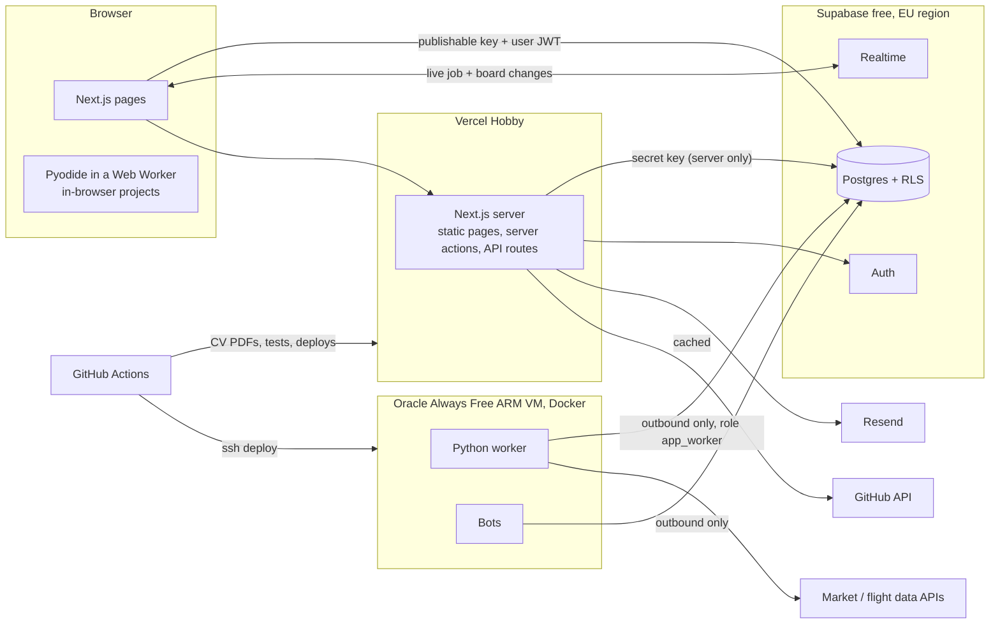
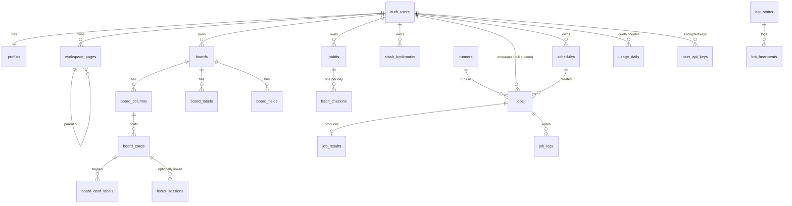
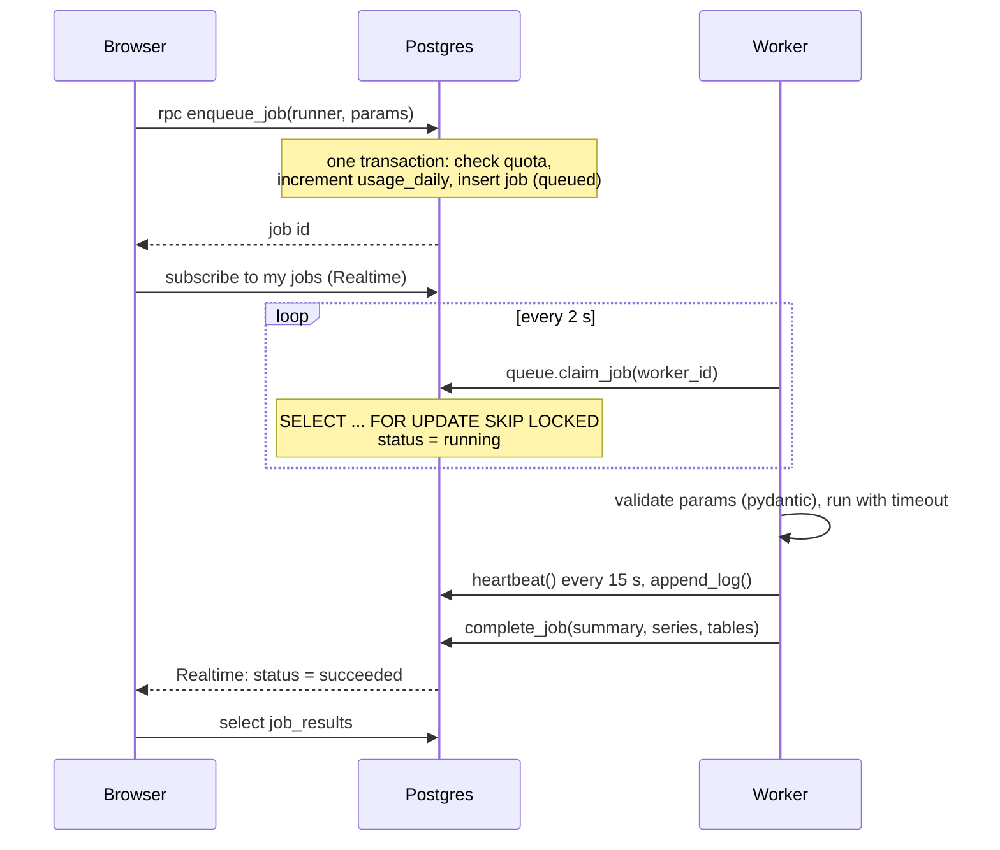
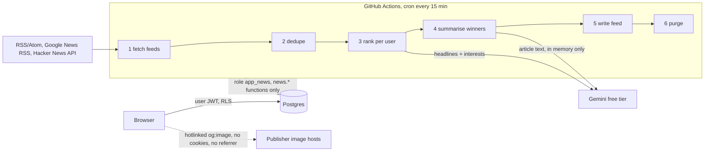

# Architecture

Personal site of Yash Contractor: a public portfolio where projects actually run, plus an
invite-only area with personal productivity apps. Budget: €0/month.

> Status legend used in this file: **built** = in the repo and tested, **planned** = decided
> but not yet implemented. Keep it honest when you change things.

## 1. System overview



Four places run code, and each has exactly one job:

| Where | Runs | Talks to the database as |
|---|---|---|
| Browser | UI, and Python projects via Pyodide | the logged-in user (RLS decides what they see) |
| Vercel | Page rendering, contact form, signup, API-key encryption, demo runs | `service_role` (bypasses RLS, never leaves the server) |
| Worker VM | Runner jobs and bots | `app_worker` (can only call `queue.*` functions) |
| GitHub Actions (planned) | News pipeline, every 15 minutes | `app_news` (can only call `news.*` functions) |

The VM exposes **no public ports**. It only makes outbound connections, so there is nothing
on it to attack from the internet except SSH (key-only, used by the deploy workflow).

## 2. Repository layout

```
web/                 Next.js 16 app (App Router, TypeScript strict, Tailwind 4, next-intl)  built (Phase 1 in progress)
worker/              Python worker: queue loop + one module per runner, Dockerfile       built
bots/                Long-running bots (badminton monitor)                              planned
news/                News pipeline (Python, run by a scheduled GitHub Action)           partly built (fetch + store; no LLM, no workflow yet)
supabase/migrations  Database schema, RLS, functions                                    built
supabase/tests       SQL tests + run.sh (also run in CI)                                built
content/cv.yaml      CV single source of truth (EN + DE)                                built
content/cv/          Typst template for the PDF CV (built by .github/workflows/cv.yml)   built
projects/<slug>/     One folder + project.yaml per project                              built (format)
scripts/             Build/CI scripts: validate manifests, vendor code, sync runners     built
infra/               docker-compose for the worker (deploy + backup scripts planned)    partly built
docs/                This file, ROADMAP.md, CONVENTIONS.md
```

## 3. Data model

All tables live in `public` with RLS on. Full definitions: `supabase/migrations/`.



| Group | Tables | Who can touch them from the browser |
|---|---|---|
| Identity | `profiles`, `invites`, `audit_log`, `app_settings` | own profile (name, locale only); the rest server-only |
| Apps | `workspace_*`, `board*`, `focus_*`, `habit*`, `stash_bookmarks` | owner only, full read/write |
| Runner | `jobs`, `job_results`, `job_logs`, `usage_daily`, `schedules` | owner read-only; writes only through functions |
| Secrets | `user_api_keys` | owner sees provider + last 4 chars; ciphertext unreadable |
| Shared cache | `price_bars`, `external_cache` | nobody; worker only |
| Public | `runners`, `bot_status`, `bot_heartbeats` | everyone, read-only |
| News (planned) | `news_articles`, `news_topics`, `news_runs` | logged-in users, read-only; written by the pipeline only |
| News, per user (planned) | `news_prefs`, `news_feed_items`, `news_feedback` | owner only: prefs and feedback read/write, feed items read-only |

### Security rules baked into the schema (all covered by tests)

1. **Deny by default.** The first migration removes Supabase's default "browser can access
   every new table" grants. Each table grants the minimum explicitly.
2. **Owner-only RLS.** Every user table has `user_id` and one policy: `user_id = auth.uid()`.
3. **Composite foreign keys.** A child row references `(parent_id, user_id)`, so the database
   itself refuses a card in someone else's board, even if a policy were ever wrong.
4. **Writes that cost money go through functions.** A browser cannot insert into `jobs`.
   `enqueue_job()` checks the quota and inserts in one transaction.
5. **Column-level grants.** Users cannot update `profiles.role` or `daily_run_limit`, and
   cannot select `user_api_keys.ciphertext`.
6. **Invite-only signup is enforced by a trigger on `auth.users`**, so no API path skips it.
   Codes are stored as SHA-256 hashes.
7. **Least-privilege worker.** `app_worker` has no table access except the price cache. A
   leaked worker password cannot read notes.
8. **Least-privilege news pipeline.** `app_news` has no table access at all; it reads and
   writes only through the `news.*` functions.
9. **Size and row caps** on every user-writable column and table protect the 500 MB database.

Honest limit: RLS protects users from each other. The site operator (service key, database
owner) can technically read stored notes. That is why the notes table is shaped for optional
end-to-end encryption (Phase 4): one opaque document per page, with `content_cipher` ready.

## 4. Runner system ("like a GitHub Action")



- **Queue = a Postgres table.** `FOR UPDATE SKIP LOCKED` lets several workers poll at once;
  each locks a different row. No Redis, nothing extra to host or pay for.
- **Quota** (5 runs/day, 25 with your own API key) is an atomic
  `INSERT ... ON CONFLICT DO UPDATE ... WHERE runs < limit`. If it updates no row, the run is
  rejected. Days are UTC. A run rejected for any reason does not consume quota.
- **Failure handling.** Retryable errors go back to the queue with backoff (30 s, 60 s, ...).
  `reap_stale()` re-queues jobs whose worker stopped sending heartbeats for 90 s.
  `heartbeat()` returning false tells a worker its job was cancelled or reaped.
- **Worker internals** (`worker/worker/`): `main.py` is the loop, `execute.py` runs each job in a
  spawned child process (hard timeout, CPU/memory limits, killed on cancel), `contract.py`
  defines `Params` in and `Result` out, `runners/__init__.py` maps slug to module.
  `monte-carlo-pi` is the reference runner; `stock-sim` is a skeleton Yash implements.
- **Demo runs** (guests): the Next.js server rate-limits by IP (HMAC of the IP, never the raw
  IP), calls `queue.enqueue_demo()` with fixed params and a random token, and the browser
  polls a server route with that token. Demo jobs are invisible to all users and deleted
  within the hour, so every demo starts from the same state.
- **Bring your own key.** The key is encrypted in the Next.js server with AES-256-GCM
  (`API_KEY_ENC_KEY_V1`, 32 random bytes, held by web and worker only). The worker can fetch
  the ciphertext only for a job it currently holds (`queue.get_job_api_key`).
- **Shared cache.** `price_bars` stores daily prices once per ticker for all users.
- **Scheduling.** The worker calls `queue.enqueue_due_schedules()` once a minute. Scheduled
  runs pass through the same quota check.

## 5. Project system

`projects/<slug>/project.yaml` is the only thing needed to add a project. Format:
`projects/project.schema.json` (validated in CI by `scripts/validate_manifests.py`).

| type | What the Run tab does | Backend needed |
|---|---|---|
| `static` | nothing: README overview, plus an optional MDX write-up in the folder | none |
| `in-browser` | runs the Python file in Pyodide inside a Web Worker, xterm.js as terminal | none |
| `runner` | form generated from `runner.inputs`, job goes to the queue | worker |
| `bot-status` | read-only status from `bot_status` / `bot_heartbeats` | bot |

At build time Next.js reads all manifests and statically generates the project pages. A CI
step keeps the `runners` table in line with the manifests: `scripts/sync_runners.py` generates
`supabase/seed/runners.sql` (CI fails if it is stale); applying it is manual for now.
In-browser code is **vendored**: `scripts/vendor_inbrowser.py` copies the files at the pinned
commit SHA into `projects/<slug>/src/`, so the code the site runs is reviewed in this repo and
never fetched live. `web/scripts/prebuild.mjs` copies it, and the Pyodide runtime from
`node_modules`, into `web/public/` before every build (self-hosted, no CDN).

`input()` in Pyodide (**built**): the Web Worker (`web/public/py-worker.mjs`) blocks on
`Atomics.wait` over a `SharedArrayBuffer` while the page collects the line from xterm.js.
That needs cross-origin isolation, so COOP `same-origin` and COEP `require-corp` are sent on
every page (site-wide, because client-side navigation keeps the first page's headers).
Consequence: cross-origin images and scripts are blocked unless CORS-enabled; README images
are therefore not rendered.

## 6. Auth

- Supabase Auth, email + password, email verification, password reset. **built, client-side**:
  the browser calls Supabase Auth directly with the publishable key (`web/src/components/AuthForm.tsx`).
  The session lives in the browser; `AuthProvider` exposes it via `useAuth()`. Public pages stay static.
- Private apps (`web/src/apps/<name>/`) talk to Postgres straight from the browser through
  supabase-js. RLS is the security boundary, not the UI. Each app has one store interface with a
  `demo` implementation (guests) and a `supabase` implementation (logged in); `useStore` picks.
- Signup passes the invite code as metadata; the database trigger validates and claims it.
- Bootstrap the first admin once, in the Supabase SQL editor:
  ```sql
  select private.create_invite('bootstrap', interval '1 day', null);   -- copy the code, sign up
  update public.profiles set role = 'admin' where id = '<your user id>';
  ```
- Admin panel pages run on the server, check `is_admin()` first, then use the secret key.

## 7. News app (planned, roadmap item 29)

A short, finite, per-user feed of recent news shown as reel-style cards. Logged-in users only.



- **Where it runs.** `news/` is a Python package run by `.github/workflows/news.yml` (schedule +
  manual trigger). It connects as
  the database role `app_news`, which can only call `news.*` functions (same idea as `app_worker`
  and `queue.*`). The Supabase secret key is not used and never enters GitHub.
- **Who gets it.** `profiles.news_enabled` (default off; users cannot change it themselves).
  The pipeline builds feeds only for enabled accounts and the shared tables are readable only
  by them. Today that is Yash alone: the Gemini unpaid tier may not serve an app offered to
  other EEA users, and every enabled account costs requests.
- **Two layers.** A shared pool (`news_articles`: metadata, link, one generated summary) and a
  per-user layer (`news_feed_items`: rank, "why this matters to you"). An article is fetched,
  deduplicated and summarised at most once, however many users see it.
- **Rank first, summarise second.** Each user's newest 150 candidates are ranked on headline +
  snippet in one batched LLM call, following the priority order in the user's free-text
  interests; it also returns the "why" note (2-5 keywords) for the top N. Only articles in
  some user's current top N are then summarised: their pages are read in memory
  (`news/article.py`) and summarised in about 500 words, 5 per request, at most 2 requests
  per run. Per run that is `users + 2` requests at most, and zero when nothing changed.
- **Free-tier budget.** Limits read from Yash's AI Studio rate-limit page on 2026-11-16, for
  both `gemini-3.5-flash-lite` (default) and `gemini-3.1-flash-lite` (fallback): 15 requests/min,
  250,000 input tokens/min, 500 requests/day. The pipeline stops at 70 % of the daily limit (350),
  counted in the database (`news_llm_usage`). One user: at most 96 ranking requests a day
  plus the summaries of cards that newly reach the top N, well under 350. With
  three or more users the worst case exceeds 350, so the pipeline lowers the effective N and
  then skips ranking runs rather than failing. On HTTP 429: back off, then the fallback model,
  then record the run as `limited`; the UI shows "limited, showing older items".
- **N is capped twice.** The user picks 5 to 20 (default 10); the pipeline clamps it to
  `max_n` in `news/config/llm.yaml`, so the budget, not the UI, has the last word.
- **Config, not code.** `news/config/sources.yaml` (presets, feeds, Google News queries, Hacker
  News settings) and `news/config/llm.yaml` (model names, caps, batch sizes). The pipeline
  upserts the presets into `news_topics` on every run, so there is no manual seed step.
- **Idempotent.** Unique key on the hash of the canonical URL, upserts everywhere, each stage in
  its own transaction, and a workflow `concurrency` group so two runs never overlap. A failed
  run leaves earlier stages committed and is simply repeated by the next one.
- **No article text is stored.** The body is fetched and extracted (trafilatura) in memory for
  summarising only. robots.txt is respected (unreadable robots.txt means stay away), only
  public internet addresses are fetched and every redirect is re-checked (SSRF guard), and
  pages are capped at 2 MB. Paywalled or blocked pages fall back to the feed teaser, or to
  the headline alone, and the prompt tells the model which one it got so it writes less.
  Rows are purged after 3 days (feedback is kept for later learning).
- **Untrusted input.** Article text and the user's free-text interests are data, never
  instructions: they go into clearly delimited blocks of the prompt, the model's answer must
  validate against a strict pydantic schema or it is dropped, and the UI renders summaries as
  plain text nodes.
- **Browser side.** No new API routes. The app reads feed items and writes prefs and feedback
  through supabase-js under RLS, check constraints and row caps, like Board. The registry entry
  is marked `auth: "required"`: hidden from the dock and the palette for guests, and the page
  shell is static, holds no data and redirects guests to login. Articles are readable by the
  `authenticated` role only, so the database is the gate (see section 6).
- **Images.** `og:image` URLs are hotlinked, never downloaded or stored. To make that possible
  the site moves from COEP `require-corp` to `credentialless` (cross-origin images load without
  cookies; cross-origin isolation for the Pyodide terminal stays) and `img-src` widens to
  `https:`. Images use `referrerpolicy="no-referrer"`. Trade-offs: the reader's IP reaches the
  publisher's image host, and browsers without `credentialless` support lose `input()` in the
  in-browser games (to be verified in Safari before this ships). Fallback when there is no image
  or it fails to load: a generated gradient plus the topic icon.
- **Known limits.** GitHub cron can start 5 to 30 minutes late, so "in the feed within 30
  minutes" is a normal-conditions target. GitHub disables scheduled workflows after 60 days
  without repository activity; re-enable under Actions > News pipeline > Enable workflow. The
  repository is public, so are the workflow logs: the pipeline logs counts and ids, never
  interests or prefs. Google News RSS links are opaque redirects; when one cannot be resolved the
  card has no image and the summary is based on headline + snippet.

## 8. Hosting and free-tier limits (checked November 2026)

| Service | Limit that matters | How we stay inside |
|---|---|---|
| Vercel Hobby | non-commercial use only | personal portfolio, no ads, no sales |
| Supabase Free | 500 MB database, 2 projects, pauses after 7 days idle | row caps, purge job, worker polling keeps it awake, plus a daily keep-alive GitHub Action |
| Oracle Always Free | Ampere A1: 2 OCPU + 12 GB total (halved in 2026) | one VM at or below that size |
| Resend Free | 100 emails/day, 3,000/month, sending to others needs a verified domain | signup rate limit; until the domain exists only the owner's address works |
| GitHub Actions | free for public repos; cron may run late; schedules are disabled after 60 days without repo activity | repo is public; the news run is idempotent, so a late or skipped run only delays the feed |
| Gemini API free tier (planned) | 15 requests/min, 250k input tokens/min, 500 requests/day per Flash-Lite model, no billing account | batched calls, stop at 70 % per day, fallback model, visible 'limited' state |

Fallback if Oracle capacity or policy changes: the worker is one `docker compose up` with
environment variables. Any €4/month VPS runs it unchanged (ask Yash before spending).

Worker database connection: Supabase's direct host is IPv6-only on the free plan, so use the
**session pooler** connection string (IPv4, port 5432) with user `app_worker.<project-ref>`.
Enable the role once by hand: `alter role app_worker login password '<long random>';`

## 9. Key decisions

| Decision | Why | Trade-off |
|---|---|---|
| Postgres table as job queue | one less service, transactional with quota | polling, fine at this scale |
| Quota inside the database | cannot be bypassed by calling the API directly | logic lives in SQL |
| Manifests in the repo, not the DB | adding a project is one folder, reviewed in git | needs a small sync step for runners |
| Denormalised `user_id` + composite FKs | simple, fast, hard-to-break RLS | one extra column per table |
| Fractional-index `position` strings | reorder = update one row | positions are opaque strings |
| App-level AES-GCM for API keys | portable, easy to explain, key never in the DB | key rotation is manual (`key_version`) |
| Typst for the CV | fast, simple template, runs in CI in seconds | less common than LaTeX |
| BlockNote for Workspace | Notion-style editor out of the box | less low-level control than Tiptap |
| No tracking, no cookies beyond auth | GDPR: no consent banner needed | no visitor analytics by default |
| News pipeline on GitHub Actions cron (planned) | free, no server to keep alive, secrets stay in GitHub | start times are not exact |
| Rank on headlines, summarise only top-N articles (planned) | fits the free LLM tier; each article summarised once for all users | ranking sees less text than the summary does |
| LLM behind a provider interface (planned) | model or vendor can be swapped in config | one more small abstraction |
| COEP `credentialless` instead of `require-corp` (planned) | lets hotlinked news images load while keeping cross-origin isolation | not supported in every browser |

## 10. Open items that need Yash

- Impressum: German law requires a real postal address for most sites. Options to discuss
  before Phase 2 ships (do not decide for him).
- Phone is left out of `cv.yaml` on purpose (public repo). Email stays in and is public (confirmed by Yash 2026-11-13).
- Domain (GitHub Student Pack) and then Resend domain verification.
- News app: read the Gemini API terms (ai.google.dev/gemini-api/terms) before the LLM step is
  switched on: whether the unpaid tier may be used for an app offered to users in the EEA, and
  how Google may use free-tier prompts (the free-text interests are sent to it). The privacy
  policy (item 17) must mention Gemini and the hotlinked images.
