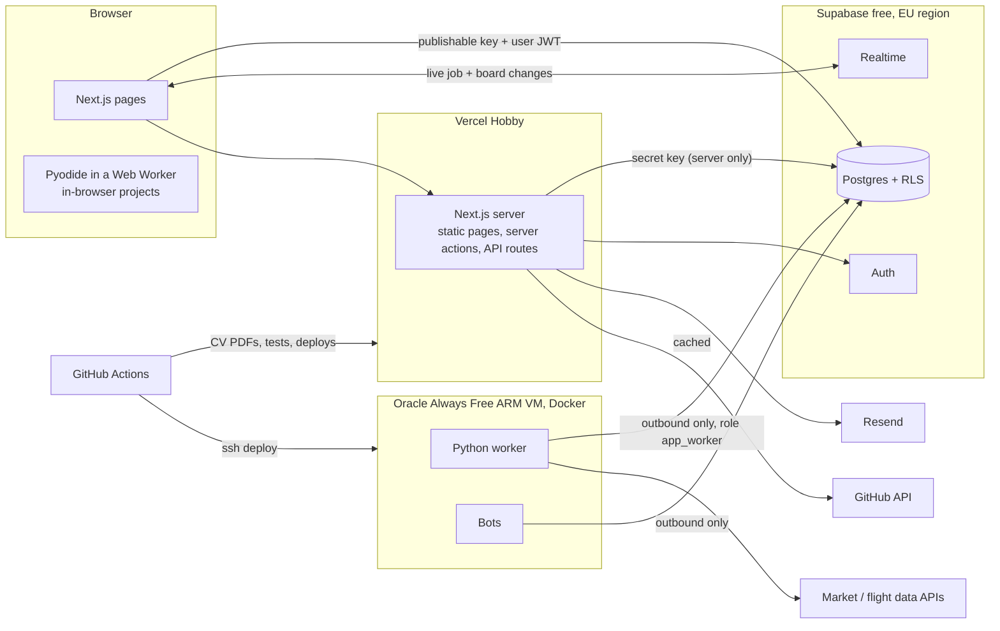
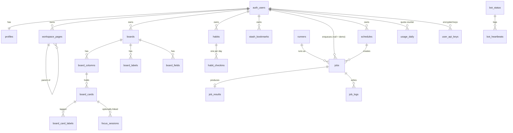
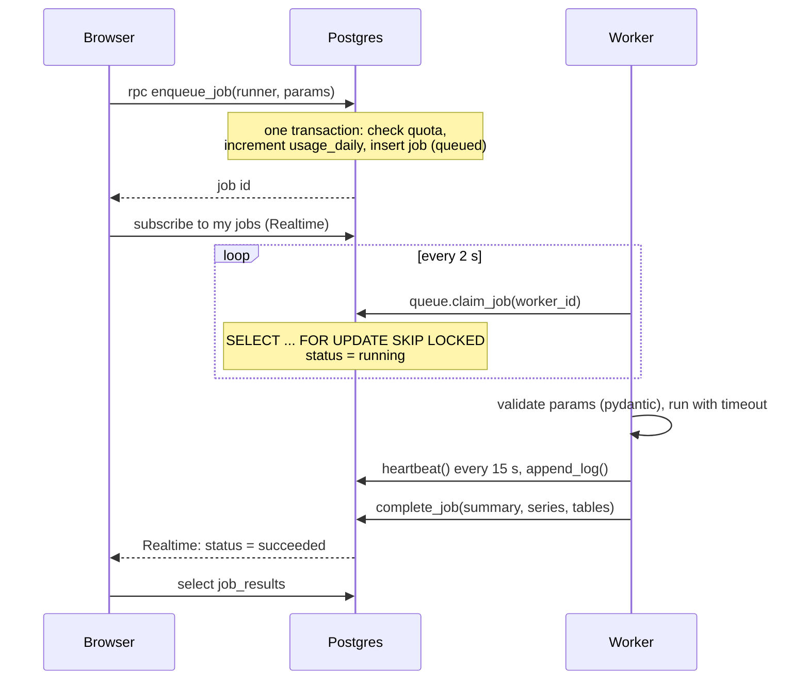

# Architecture

Personal site of Yash Contractor: a public portfolio where projects actually run, plus an
invite-only area with personal productivity apps. Budget: €0/month.

> Status legend used in this file: **built** = in the repo and tested, **planned** = decided
> but not yet implemented. Keep it honest when you change things.

## 1. System overview



Three places run code, and each has exactly one job:

| Where | Runs | Talks to the database as |
|---|---|---|
| Browser | UI, and Python projects via Pyodide | the logged-in user (RLS decides what they see) |
| Vercel | Page rendering, contact form, signup, API-key encryption, demo runs | `service_role` (bypasses RLS, never leaves the server) |
| Worker VM | Runner jobs and bots | `app_worker` (can only call `queue.*` functions) |

The VM exposes **no public ports**. It only makes outbound connections, so there is nothing
on it to attack from the internet except SSH (key-only, used by the deploy workflow).

## 2. Repository layout

```
web/                 Next.js 16 app (App Router, TypeScript strict, Tailwind 4, next-intl)  built (Phase 1 in progress)
worker/              Python worker: queue loop + one module per runner, Dockerfile       planned
bots/                Long-running bots (badminton monitor)                              planned
supabase/migrations  Database schema, RLS, functions                                    built
supabase/tests       SQL tests + run.sh (also run in CI)                                built
content/cv.yaml      CV single source of truth (EN + DE)                                built
content/cv/          Typst template for the PDF CV (built by .github/workflows/cv.yml)   built
projects/<slug>/     One folder + project.yaml per project                              built (format)
scripts/             Small build/CI scripts (manifest validation, runner sync)          partly built
infra/               docker-compose, deploy scripts, backup workflow notes              planned
docs/                This file, ROADMAP.md, CONVENTIONS.md
```

## 3. Data model

All tables live in `public` with RLS on. Full definitions: `supabase/migrations/`.



| Group | Tables | Who can touch them from the browser |
|---|---|---|
| Identity | `profiles`, `invites`, `audit_log`, `app_settings` | own profile (name, locale only); the rest server-only |
| Apps | `workspace_*`, `board*`, `focus_*`, `habit*`, `stash_bookmarks` | owner only, full read/write |
| Runner | `jobs`, `job_results`, `job_logs`, `usage_daily`, `schedules` | owner read-only; writes only through functions |
| Secrets | `user_api_keys` | owner sees provider + last 4 chars; ciphertext unreadable |
| Shared cache | `price_bars`, `external_cache` | nobody; worker only |
| Public | `runners`, `bot_status`, `bot_heartbeats` | everyone, read-only |

### Security rules baked into the schema (all covered by tests)

1. **Deny by default.** The first migration removes Supabase's default "browser can access
   every new table" grants. Each table grants the minimum explicitly.
2. **Owner-only RLS.** Every user table has `user_id` and one policy: `user_id = auth.uid()`.
3. **Composite foreign keys.** A child row references `(parent_id, user_id)`, so the database
   itself refuses a card in someone else's board, even if a policy were ever wrong.
4. **Writes that cost money go through functions.** A browser cannot insert into `jobs`.
   `enqueue_job()` checks the quota and inserts in one transaction.
5. **Column-level grants.** Users cannot update `profiles.role` or `daily_run_limit`, and
   cannot select `user_api_keys.ciphertext`.
6. **Invite-only signup is enforced by a trigger on `auth.users`**, so no API path skips it.
   Codes are stored as SHA-256 hashes.
7. **Least-privilege worker.** `app_worker` has no table access except the price cache. A
   leaked worker password cannot read notes.
8. **Size and row caps** on every user-writable column and table protect the 500 MB database.

Honest limit: RLS protects users from each other. The site operator (service key, database
owner) can technically read stored notes. That is why the notes table is shaped for optional
end-to-end encryption (Phase 4): one opaque document per page, with `content_cipher` ready.

## 4. Runner system ("like a GitHub Action")



- **Queue = a Postgres table.** `FOR UPDATE SKIP LOCKED` lets several workers poll at once;
  each locks a different row. No Redis, nothing extra to host or pay for.
- **Quota** (5 runs/day, 25 with your own API key) is an atomic
  `INSERT ... ON CONFLICT DO UPDATE ... WHERE runs < limit`. If it updates no row, the run is
  rejected. Days are UTC. A run rejected for any reason does not consume quota.
- **Failure handling.** Retryable errors go back to the queue with backoff (30 s, 60 s, ...).
  `reap_stale()` re-queues jobs whose worker stopped sending heartbeats for 90 s.
  `heartbeat()` returning false tells a worker its job was cancelled or reaped.
- **Demo runs** (guests): the Next.js server rate-limits by IP (HMAC of the IP, never the raw
  IP), calls `queue.enqueue_demo()` with fixed params and a random token, and the browser
  polls a server route with that token. Demo jobs are invisible to all users and deleted
  within the hour, so every demo starts from the same state.
- **Bring your own key.** The key is encrypted in the Next.js server with AES-256-GCM
  (`API_KEY_ENC_KEY_V1`, 32 random bytes, held by web and worker only). The worker can fetch
  the ciphertext only for a job it currently holds (`queue.get_job_api_key`).
- **Shared cache.** `price_bars` stores daily prices once per ticker for all users.
- **Scheduling.** The worker calls `queue.enqueue_due_schedules()` once a minute. Scheduled
  runs pass through the same quota check.

## 5. Project system

`projects/<slug>/project.yaml` is the only thing needed to add a project. Format:
`projects/project.schema.json` (validated in CI by `scripts/validate_manifests.py`).

| type | What the Run tab does | Backend needed |
|---|---|---|
| `static` | nothing: README overview, plus an optional MDX write-up in the folder | none |
| `in-browser` | runs the Python file in Pyodide inside a Web Worker, xterm.js as terminal | none |
| `runner` | form generated from `runner.inputs`, job goes to the queue | worker |
| `bot-status` | read-only status from `bot_status` / `bot_heartbeats` | bot |

At build time Next.js reads all manifests and statically generates the project pages. A CI
step upserts `runner` manifests into the `runners` table (planned: `scripts/sync-runners`).
In-browser code is **vendored**: `scripts/vendor_inbrowser.py` copies the files at the pinned
commit SHA into `projects/<slug>/src/`, so the code the site runs is reviewed in this repo and
never fetched live. `web/scripts/prebuild.mjs` copies it, and the Pyodide runtime from
`node_modules`, into `web/public/` before every build (self-hosted, no CDN).

`input()` in Pyodide (**built**): the Web Worker (`web/public/py-worker.mjs`) blocks on
`Atomics.wait` over a `SharedArrayBuffer` while the page collects the line from xterm.js.
That needs cross-origin isolation, so COOP `same-origin` and COEP `require-corp` are sent on
every page (site-wide, because client-side navigation keeps the first page's headers).
Consequence: cross-origin images and scripts are blocked unless CORS-enabled; README images
are therefore not rendered.

## 6. Auth

- Supabase Auth, email + password, email verification, password reset. **planned**
- Signup passes the invite code as metadata; the database trigger validates and claims it.
- Bootstrap the first admin once, in the Supabase SQL editor:
  ```sql
  select private.create_invite('bootstrap', interval '1 day', null);   -- copy the code, sign up
  update public.profiles set role = 'admin' where id = '<your user id>';
  ```
- Admin panel pages run on the server, check `is_admin()` first, then use the secret key.

## 7. Hosting and free-tier limits (checked November 2026)

| Service | Limit that matters | How we stay inside |
|---|---|---|
| Vercel Hobby | non-commercial use only | personal portfolio, no ads, no sales |
| Supabase Free | 500 MB database, 2 projects, pauses after 7 days idle | row caps, purge job, worker polling keeps it awake, plus a daily keep-alive GitHub Action |
| Oracle Always Free | Ampere A1: 2 OCPU + 12 GB total (halved in 2026) | one VM at or below that size |
| Resend Free | 100 emails/day, 3,000/month, sending to others needs a verified domain | signup rate limit; until the domain exists only the owner's address works |
| GitHub Actions | free for public repos | repo is public |

Fallback if Oracle capacity or policy changes: the worker is one `docker compose up` with
environment variables. Any €4/month VPS runs it unchanged (ask Yash before spending).

Worker database connection: Supabase's direct host is IPv6-only on the free plan, so use the
**session pooler** connection string (IPv4, port 5432) with user `app_worker.<project-ref>`.
Enable the role once by hand: `alter role app_worker login password '<long random>';`

## 8. Key decisions

| Decision | Why | Trade-off |
|---|---|---|
| Postgres table as job queue | one less service, transactional with quota | polling, fine at this scale |
| Quota inside the database | cannot be bypassed by calling the API directly | logic lives in SQL |
| Manifests in the repo, not the DB | adding a project is one folder, reviewed in git | needs a small sync step for runners |
| Denormalised `user_id` + composite FKs | simple, fast, hard-to-break RLS | one extra column per table |
| Fractional-index `position` strings | reorder = update one row | positions are opaque strings |
| App-level AES-GCM for API keys | portable, easy to explain, key never in the DB | key rotation is manual (`key_version`) |
| Typst for the CV | fast, simple template, runs in CI in seconds | less common than LaTeX |
| BlockNote for Workspace | Notion-style editor out of the box | less low-level control than Tiptap |
| No tracking, no cookies beyond auth | GDPR: no consent banner needed | no visitor analytics by default |

## 9. Open items that need Yash

- Impressum: German law requires a real postal address for most sites. Options to discuss
  before Phase 2 ships (do not decide for him).
- Phone is left out of `cv.yaml` on purpose (public repo). Email stays in and is public (confirmed by Yash 2026-11-13).
- Domain (GitHub Student Pack) and then Resend domain verification.
