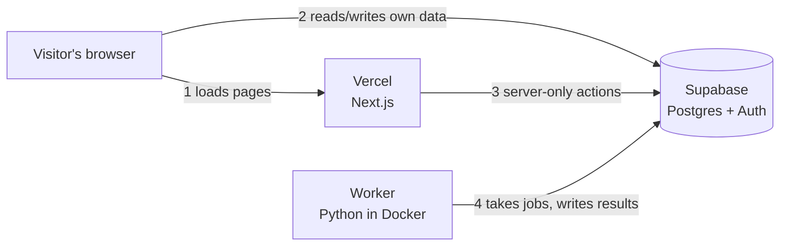
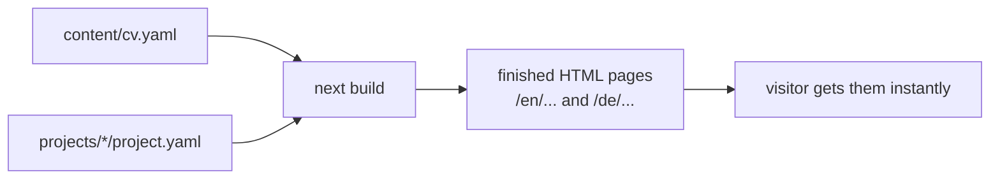
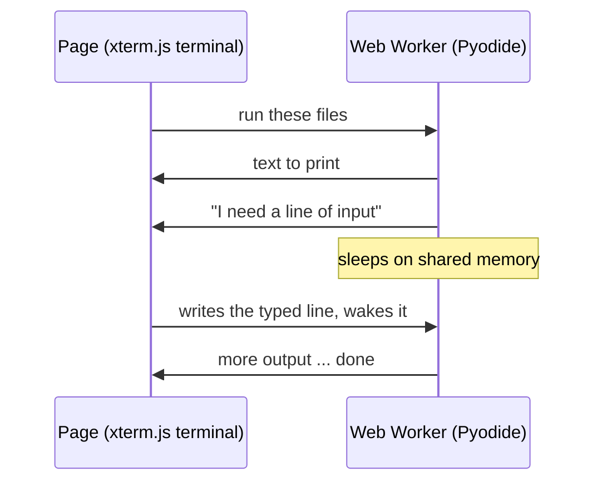
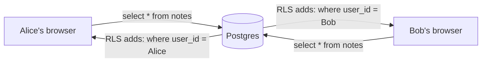
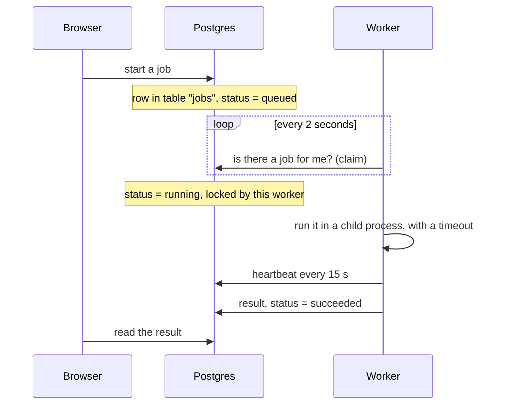
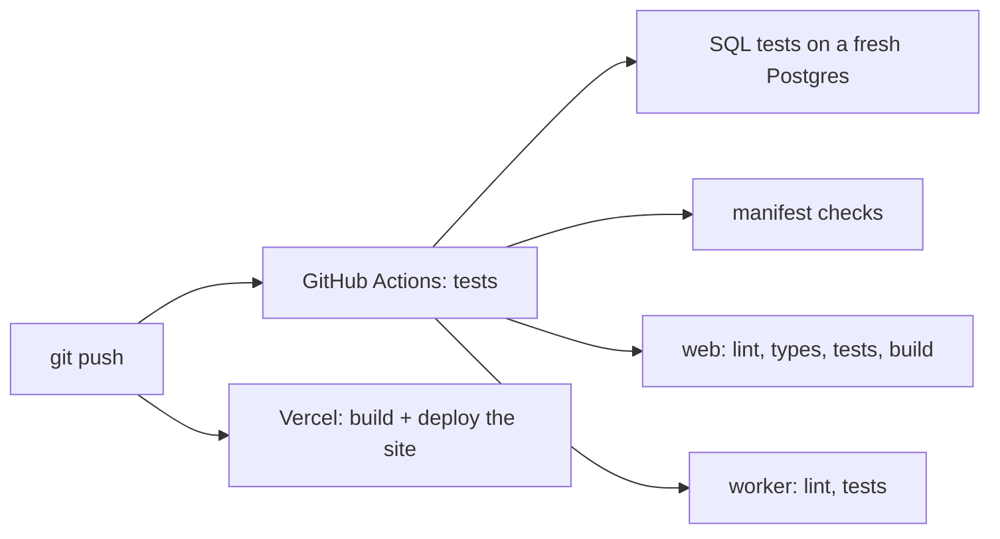

# Walkthrough: how this site works, from scratch

Written for Yash, to learn the project well enough to explain every part of it.
`ARCHITECTURE.md` is the reference; this file is the story. Read it top to bottom once, then
open the files it names. Each part ends with questions an interviewer might ask.

Everything described here is built unless a line says "not built yet".

## 0. The 30-second pitch

> "It's my portfolio, but the projects actually run on it. Small Python programs run in the
> visitor's browser through WebAssembly. Heavier ones go into a job queue I built on Postgres
> and are executed by a Python worker in Docker. Behind a login there are two private apps, a
> notes editor and a kanban board, where the database itself guarantees each user only sees
> their own data. It all runs on free tiers."

## 1. The big picture

Code runs in three places. Knowing which code runs where explains most design decisions.



| Place | What runs there | What it is trusted with |
|---|---|---|
| Browser | The pages, the Python games, the private apps | Nothing secret. It only ever holds the *publishable* key. |
| Vercel (server) | Building pages, contact form, starting demo runs | The *secret* key, the email key. |
| Worker | Jobs from the queue | One restricted database login. |

The browser and the worker never talk to each other. They only meet in the database: one
writes a row, the other reads it. That is the core idea of the queue.

**Asked:** *Why three places?* Each has one job and the minimum access for it. If one is
compromised, the damage stops there.

## 2. One repo, five folders that matter

| Folder | What is in it |
|---|---|
| `web/` | The Next.js site (TypeScript) |
| `worker/` | The Python worker |
| `supabase/` | The database: tables, security rules, functions, tests |
| `projects/` | One folder per project shown on the site |
| `content/` | `cv.yaml`, the single source for the CV |

## 3. The public site

### How a page is made

Pages are not built when someone visits. They are built once, when I push code, and stored as
finished HTML. This is called static generation.



- `web/src/lib/cv.ts` and `web/src/lib/projects.ts` read the YAML files at build time.
- `web/src/app/[locale]/page.tsx` is the homepage. `[locale]` is `en` or `de`.
- `web/src/app/[locale]/projects/[slug]/page.tsx` is the page for one project.

**Asked:** *Why is it fast?* No database call is needed to show the homepage; it is a file.

### Adding a project = adding one file

Each project is a folder with a `project.yaml` (the "manifest"): name, summary in two
languages, tags, type. At build time every manifest is checked against a schema with **zod**
(`web/src/lib/projects.ts`). A typo fails the build, so a broken manifest can never reach the
live site.

There are four types: `static` (a write-up), `in-browser` (runs in the visitor's browser),
`runner` (runs on the worker), `bot-status` (shows a bot's health; page not built yet).

### Two languages

Every URL starts with `/en` or `/de`. All visible text lives in `web/messages/en.json` and
`de.json`, and the library next-intl picks the right one. `web/src/proxy.ts` sends a visitor
who opens `/` to the language of their browser.

### The design system

Colours, fonts and radii are defined once as CSS variables in `web/src/styles/tokens.css`.
Components never contain a colour value, only names like `--accent`. That is why switching the
theme (multicolor or mono) is a single attribute on the page: the same variables get new values.

### The CV pipeline

`content/cv.yaml` feeds two things: the homepage text and a Typst template
(`content/cv/cv.typ`) that produces the PDF. When the YAML changes, a GitHub Actions workflow
(`.github/workflows/cv.yml`) rebuilds both PDFs and commits them.

**Asked:** *How do you keep your CV in sync?* One file, two outputs, rebuilt automatically.

## 4. Python in the browser



- **Pyodide** is the real Python interpreter compiled to WebAssembly, so it runs inside a
  browser tab. Nothing is sent to my server.
- It runs in a **Web Worker**, which is a second thread. The page stays responsive even if the
  Python code loops forever, and "Stop" just kills that thread.
- **The hard part is `input()`.** Python expects to stop and wait; a browser never waits. The
  worker goes to sleep with `Atomics.wait` on a `SharedArrayBuffer` (memory both threads can
  see). When the visitor presses Enter, the page writes the line there and wakes the worker.
- Browsers only allow `SharedArrayBuffer` on "cross-origin isolated" pages, so the site sends
  two security headers (COOP and COEP), set in `web/next.config.ts`.
- The game code is copied into this repo at a fixed commit (`scripts/vendor_inbrowser.py`), so
  the site never runs code it loaded live from somewhere else.

Files: `web/src/components/PyTerminal.tsx` (page side), `web/public/py-worker.mjs` (worker side).

**Asked:** *Is that safe?* The code runs in the visitor's own browser sandbox. It cannot reach
my database or anyone else's data.

## 5. Accounts and the private apps

### Who can sign up

Registration needs an invite code. The check is not in the website; it is a **trigger in the
database** on the users table (`supabase/migrations/…foundation.sql`). Whatever path a signup
takes, the database refuses it without a valid, unused code. Codes are stored only as hashes.

### How private data stays private: row-level security

This is the most important idea in the project.

The browser talks to Postgres directly (through Supabase's API). So the website cannot be what
protects the data, because anyone can skip the website and call the API. Instead, every table
has **row-level security (RLS)**: a rule inside the database that is applied to every query.

```sql
-- the rule on every user table, in words: "you only ever see rows where user_id is you"
using (user_id = auth.uid())
```



Extra layers on top:
- **Deny by default.** A new table is unreachable from the browser until access is granted.
- **Composite foreign keys.** A card stores its owner and points at `(board, owner)`. The
  database refuses a card in someone else's board even if a rule were wrong.
- **Tests.** `supabase/tests/` logs in as a second user and tries to read, change and delete
  the first user's data. CI runs these on every push.

**Asked:** *How do you keep users' data private?* RLS on every table, deny-by-default grants,
and tests that try to break in. The UI is not the security boundary.

**Honest limit:** RLS protects users from each other. I, as the operator, could technically
read stored notes. End-to-end encryption is planned for that (not built yet).

### Demo for guests, real data for users

Each app talks to a "store": an interface listing what the app needs (`list`, `create`,
`update` …). There are two implementations: `demo.ts` keeps sample data in memory, and
`supabase.ts` talks to the database. `web/src/apps/useStore.ts` picks one based on whether you
are logged in. The UI code is identical for both.

### Workspace (notes)

`web/src/apps/workspace/`. The editor is the BlockNote library. A page's content is one JSON
document. Autosave waits until you stop typing for 800 ms ("debounce"), then writes once.

### Board (kanban)

`web/src/apps/board/Board.tsx`. Three ideas to be able to explain:

1. **Optimistic updates.** When you drop a card, the screen changes first and the database is
   told second. If the write fails, the board reloads the true state.
2. **Fractional indexing.** A card's order is a text key such as `a1`. To put a card between
   `a1` and `a2`, it gets a key in between, like `a1V`. Only that one row is written; no other
   card is renumbered.
3. **Live sync.** Supabase Realtime pushes row changes over a WebSocket, so a second tab
   updates itself. The same RLS rules apply to those messages.

Undo keeps a list of "how to reverse the last change" functions; ⌘Z runs the newest one.

## 6. The job queue ("like a GitHub Action")

Some projects are too heavy for a browser. Those become **jobs**.



- **The queue is a table.** No Redis or other service. A job is a row in `jobs`.
- **Claiming** uses `SELECT … FOR UPDATE SKIP LOCKED`: "give me one queued row and lock it; if
  another worker already locked a row, skip it". Two workers can never take the same job.
- **Quotas are enforced in the database.** The browser cannot insert a job. It calls the
  function `enqueue_job`, which checks today's count and inserts the job in one transaction.
  Calling the API directly does not get around it. (The form for logged-in users to start
  their own runs is not built yet; the database side is, and it is tested.)
- **If a job hangs,** it is running in its own process with a timer; the worker kills it.
- **If the worker dies,** its jobs stop sending heartbeats. After 90 seconds a job is put back
  in the queue (`reap_stale`).
- **The worker has its own database login** (`app_worker`) that can only call the queue
  functions. It cannot read notes or boards.

Files: `supabase/migrations/…runner.sql` (queue functions), `worker/worker/main.py` (the loop),
`worker/worker/execute.py` (child process + timeout), `worker/worker/contract.py` (what a
runner receives and returns), `worker/worker/runners/` (one file per runner).

### Demo runs for guests

A guest has no account, so the database cannot identify them. The server route
`web/src/app/api/demo/route.ts` rate-limits by a hashed IP, starts a job with fixed inputs,
and gives the browser a random token. Only that token can read the result, and demo jobs are
deleted within the hour.

**Asked:** *How does your job queue work?* A Postgres table; workers claim rows with
`FOR UPDATE SKIP LOCKED`; heartbeats and a reaper handle crashes; quotas are checked in the
same transaction that inserts the job.

## 7. The contact form

`web/src/app/api/contact/route.ts`. Three spam defences without a captcha: a hidden "honeypot"
field only bots fill in, a time trap (under 3 seconds is dropped), and a rate limit counted in
Postgres. The message is emailed through Resend and stored nowhere.

## 8. How code gets to production



Database changes are SQL files in `supabase/migrations/`, applied by hand in the Supabase SQL
editor for now. The worker runs with `docker compose` on my Mac until the Oracle VM exists.

## 9. Security in one page

| Threat | What stops it |
|---|---|
| Reading another user's data | Row-level security on every table, tested |
| SQL injection | Values are always sent as parameters, never pasted into SQL |
| Script injection (XSS) | React escapes output; READMEs render without raw HTML; content security policy |
| Leaked secrets | Secret keys exist only on the server (Vercel) and in the worker's local `.env` |
| Signing up without an invite | Database trigger |
| Running unlimited jobs | Quota inside the database; demo runs rate-limited and fixed-input |
| A runaway job | Child process, timeout, CPU and memory limits |
| Spam through the form | Honeypot, time trap, rate limit |

Not done yet: my own rate limits on login and signup, a review of dependency audit findings,
end-to-end encryption for notes.

## 10. Words you should be able to define

| Term | One sentence |
|---|---|
| Static generation | Pages are built once at deploy time and served as files. |
| WebAssembly | A format that lets compiled programs (here: Python itself) run in the browser. |
| Web Worker | A background thread in the browser. |
| Row-level security | A database rule that filters every query to the rows a user may see. |
| JWT | The signed token that tells the database who is logged in. |
| Optimistic update | Change the screen first, confirm with the server afterwards. |
| Debounce | Wait until activity pauses before doing the expensive thing once. |
| `SKIP LOCKED` | "Lock one free row; ignore rows someone else already locked." |
| Heartbeat | A regular "I'm still alive" signal. |
| Idempotent | Safe to run twice (the runner seed SQL is). |
| Least privilege | Every part gets only the access it needs. |

## 11. How to study this

1. Read section 5's RLS part and open `supabase/tests/10_security.sql`. Each line is a claim
   you can make in an interview, with proof.
2. Play Hangman on the site with `PyTerminal.tsx` and `py-worker.mjs` open side by side.
3. Start a demo run while watching `docker compose logs -f worker`, then find that job's row
   in the Supabase table editor.
4. Drag a card on the Board with two tabs open, then read `onDragEnd` in `Board.tsx`.
5. Explain each diagram in this file out loud without looking at the text under it.
